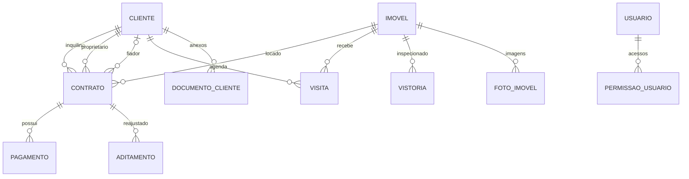

# Perugine - sistema web imobiliário

Sistema web para gestão imobiliária, desenvolvido com JavaScript, Express, React/Vite, Prisma e PostgreSQL.

## Funcionalidades implementadas

- Painel com indicadores, imóveis recentes e próximas visitas.
- Carteira de imóveis com busca, filtros, cadastro, edição, fichas e galeria de fotos.
- Cadastro de clientes com perfis, documentos e anexos PDF/imagem organizados por categoria.
- Agenda para marcar, concluir e cancelar visitas.
- Financeiro com contratos de locação, pagamentos mensais, comissão de 10%, repasse de 90% e recibo imprimível.
- Login, criação da conta administradora e permissões por pessoa e por área.
- API REST, validações de entrada e Prisma Studio para consultar o PostgreSQL.
- Banco local via Docker Compose ou PostgreSQL instalado.

A navegação principal reúne essas funções em quatro áreas: visão geral; cadastros (imóveis e clientes); contratos e financeiro; agenda e administração (visitas e equipe).

O sistema é um protótipo local para desenvolvimento acadêmico. Reajustes automáticos, alertas, auditoria e fluxos completos de encerramento de contratos ainda não estão implementados. Use somente dados fictícios. Fotos e documentos ficam em `api/uploads/`, relacionados aos registros do PostgreSQL; essa pasta é ignorada pelo Git.

## Requisitos

- Node.js 22.12 ou superior na linha 22 (detectado: 22.17.1).
- Git (já instalado).
- Docker Desktop para Windows com WSL 2, ou PostgreSQL instalado localmente.

## Abrir no IntelliJ IDEA

No IntelliJ, escolha **File > Open** e selecione a pasta `perugine-web` inteira (a que contém este README e o `package.json` principal). O IntelliJ reconhecerá os dois workspaces: `api` e `web`.

## Configurar o ambiente

Crie um arquivo `.env` na pasta principal, usando `.env.example` como referência. Defina `DATABASE_URL` para o PostgreSQL local e gere um `AUTH_SECRET` aleatório com pelo menos 32 caracteres. Nunca envie `.env` ao Git. A senha de exemplo do Compose serve apenas para desenvolvimento local; não a reutilize em outros ambientes.

## Iniciar o projeto

Abra o terminal integrado do IntelliJ na pasta principal e execute:

```powershell
npm install
npm run db:generate
npm run db:push
npm run db:seed
npm run dev
```

`db:push` cria/atualiza as tabelas diretamente a partir do esquema Prisma e não exige permissão para criar um banco temporário. Use-o no primeiro preparo e após alterações no esquema. `db:migrate` continua disponível para quando quiserem manter um histórico formal de migrações; nesse fluxo, o usuário PostgreSQL também precisa poder criar o banco temporário do Prisma.

No primeiro acesso, crie a conta administradora na tela de entrada usando uma senha com pelo menos 12 caracteres. Depois, abra **Equipe e acessos** para cadastrar pessoas e definir permissões. A API verifica as permissões; as senhas são armazenadas com hash e o token de acesso dura 12 horas na sessão do navegador.

O arquivo `.env` precisa conter `AUTH_SECRET` com uma chave aleatória forte. Gere uma chave antes de iniciar o servidor, por exemplo no PowerShell:

```powershell
[Convert]::ToHexString([Security.Cryptography.RandomNumberGenerator]::GetBytes(32))
```

Copie o resultado para `AUTH_SECRET` no `.env`. Para qualquer ambiente compartilhado, além do desenvolvimento local, configure HTTPS, proteção contra tentativas repetidas de login, recuperação de senha e políticas de privacidade apropriadas antes de armazenar dados pessoais.

### Ver o banco no Prisma Studio

Com o PostgreSQL ativo, abra outro terminal na pasta principal e execute:

```powershell
npm run db:studio
```

O terminal mostra o endereço local escolhido pelo Prisma Studio (normalmente http://localhost:5555; se essa porta estiver ocupada, ele escolhe outra). Nele, você pode abrir as tabelas, pesquisar e editar registros do banco local. Para encerrar, pressione `Ctrl+C` no terminal onde ele foi iniciado.

### O que o banco guarda

O modelo está em `api/prisma/schema.prisma`. As relações principais são:



Fotos e documentos ficam como arquivos em `api/uploads/`; o banco guarda seus nomes, categorias, tipos e vínculos com o imóvel ou cliente. O `schema.prisma` define os campos, tipos, chaves e relações; o Prisma Client permite que a API consulte e altere esses dados.

Abra http://localhost:5173. API: http://localhost:3001/api/health.

### Alternativa: Docker Desktop

O Compose está configurado em `docker-compose.yml`. Depois que o Docker Desktop estiver funcionando, execute `docker compose up -d` antes das migrações. Para encerrar o container, use `docker compose down`.

## Trabalho em equipe

Não envie `.env`, senhas ou dados reais ao Git. Façam commits pequenos e frequentes, confirmem requisitos e protótipos com a cliente e documentem no relatório as decisões que diferirem da modelagem.
